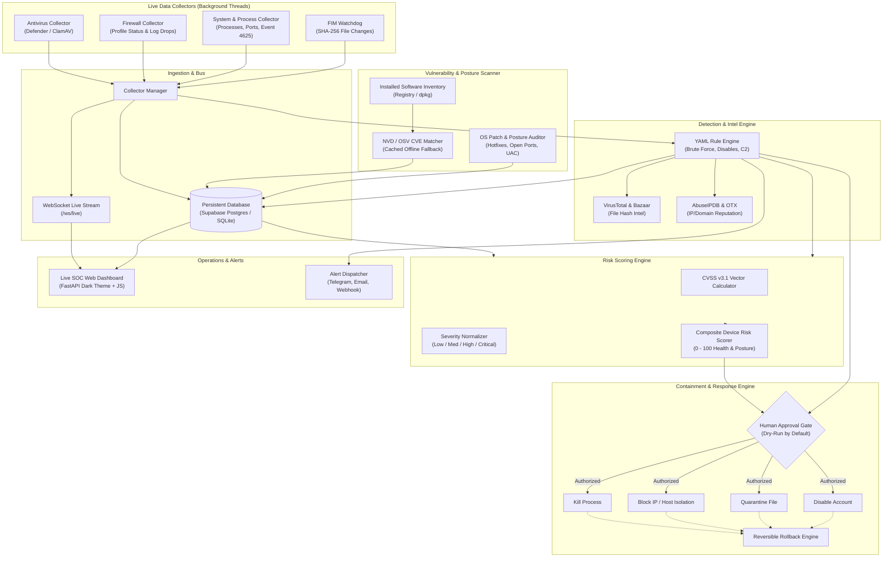

# SOAR-LITE: Safe Automated Containment Orchestrator

[](https://www.python.org/downloads/)
[](https://fastapi.tiangolo.com)
[](LICENSE)
[]()

**SOAR-LITE** is a lightweight, production-ready Security Orchestration, Automation, and Response platform. It provides continuous real-time endpoint telemetry, threat detection with external threat intelligence feeds, CVSS v3.1 risk scoring, vulnerability management, multi-channel incident alerting, and reversible automated containment playbooks guarded by mandatory human approval gates.

---

## 🏛️ Architecture Overview

SOAR-LITE operates as an event-driven SOC pipeline: live collectors stream telemetry into a persistent store and WebSocket bus; detection and vulnerability engines enrich findings; a composite CVSS risk engine evaluates device health; and automated playbooks contain verified threats with dry-run safety and 1-click rollback.

### Flowchart Architecture



---

## ⚡ Core Features

| Module | Capability | Description |
| :--- | :--- | :--- |
| **Live Telemetry Collectors** | Windows Defender & ClamAV | Monitors real-time protection, signature currency, and active malware catches. |
| | Firewall Posture & Drops | Inspects Domain/Private/Public profiles and parses drop logs (`pfirewall.log`). |
| | System, Port & Login Monitor | Detects offensive tools (`mimikatz`, `nmap`), listening ports, and Event ID 4625 failed logins. |
| | File Integrity Monitor (FIM) | Uses filesystem `watchdog` to calculate real-time SHA-256 hashes on creation or modification. |
| **Threat Detection Engine** | External Threat Intel | Enriches file hashes via VirusTotal/MalwareBazaar and IPs via AbuseIPDB/OTX. |
| | Declarative Rules Engine | YAML-driven rules matching brute force surges, disabled AV, offensive tools, and C2 traffic. |
| **Vulnerability Scanning** | Software Discovery | Enumerates software via Windows Registry (`Uninstall`) or Linux package managers. |
| | CVE Matching & Caching | Matches versions against curated offline CVE signatures and OSV API. |
| | OS Patch & Posture Audit | Checks missing OS hotfixes, risky open ports (Telnet 23, SMB 445, RDP 3389), and weak UAC. |
| **Risk & Health Scoring** | CVSS v3.1 Engine | Official FIRST CVSS v3.1 formula calculator and vector string parser (`CVSS:3.1/...`). |
| | Composite Device Scoring | Aggregates active threats and vulnerabilities into a real-time 0–100 risk and health score. |
| **Automated Response** | Containment Playbooks | `kill_process`, `block_ip`, `quarantine_file`, `disable_account`, and `host_isolation`. |
| | Safe Approval Gates | Defaults to dry-run simulations. Destructive actions require explicit operator sign-off. |
| | Instant Rollback | File restore from quarantine vault, firewall rule deletion, and account reactivation. |
| **SOC Control Room & Alerts** | Live Web Dashboard | Dark SOC interface with real-time WebSocket updates, metric cards, and 1-click containment. |
| | Multi-Channel Alerts | Dispatches High and Critical incidents via Telegram bots, SMTP email, and webhooks. |
| | Hybrid Database | Cloud PostgreSQL via Supabase with automatic, seamless fallback to local SQLite. |

---

## 📁 Repository Structure

```text
SOAR-LITE/
├── .github/                     # GitHub Workflows & CI configuration
├── config.yaml                  # Central collector, detector, and playbook configuration
├── soar_lite.db                 # Local SQLite database (auto-created when offline)
├── supabase_schema.sql          # Cloud PostgreSQL schema, indexes, and RLS policies
├── requirements.txt             # Python dependency manifest
├── README.md                    # System documentation and operational manual
│
├── soar_lite/                   # Core application package
│   ├── api/                     # REST routes and WebSocket live broadcast
│   │   ├── routes.py            # Endpoints: /api/status, /api/threats, /api/events, /api/playbooks
│   │   └── websocket.py         # Thread-safe WebSocket connection manager
│   ├── collectors/              # Background multi-threaded telemetry collectors
│   │   ├── base.py              # Base collector thread with clean shutdown events
│   │   ├── antivirus.py         # Windows Defender & ClamAV status/detection poller
│   │   ├── firewall.py          # Windows Defender Firewall auditor & log inspector
│   │   ├── system.py            # Process monitor, open port scanner, Event 4625 monitor
│   │   ├── fim.py               # Watchdog-based SHA-256 file integrity monitor
│   │   └── manager.py           # Background thread coordinator and device auto-registration
│   ├── detectors/               # Threat detectors & intelligence
│   │   ├── rules.yaml           # Declarative threat detection rules
│   │   ├── engine.py            # Event-driven rule matching & intelligence enrichment engine
│   │   ├── hash_intel.py        # VirusTotal v3 & MalwareBazaar client with rate limiting
│   │   └── reputation.py        # AbuseIPDB, AlienVault OTX, and IP geolocation client
│   ├── vuln/                    # Vulnerability management & posture audit
│   │   ├── inventory.py         # Windows Registry & dpkg software discovery
│   │   ├── nvd_matcher.py       # Offline CVE database & OSV API matcher
│   │   ├── posture.py           # OS patch (Get-HotFix), risky port & UAC posture auditor
│   │   └── scanner.py           # Consolidated vulnerability orchestrator
│   ├── scoring/                 # Risk quantification
│   │   ├── cvss.py              # Official CVSS v3.1 calculator & vector parser
│   │   ├── normalizer.py        # Severity normalizer (Low/Med/High/Critical & 0-10)
│   │   └── device_score.py      # Composite 0-100 device posture and health scorer
│   ├── response/                # Response playbooks & containment
│   │   ├── actions.py           # Real & mock handlers: kill, block, quarantine, disable
│   │   ├── rollback.py          # Reversible containment rollback handlers
│   │   └── engine.py            # Playbook execution engine with approval gates
│   ├── alerts/                  # Multi-channel notification dispatchers
│   │   ├── telegram.py          # Telegram bot message dispatcher
│   │   ├── email_alert.py       # SMTP HTML/plaintext email dispatcher
│   │   └── dispatcher.py        # Severity filter (High/Critical) and notification router
│   ├── dashboard/               # Live SOC Control Room Web Interface
│   │   ├── index.html           # Responsive dark-theme operations console
│   │   ├── styles.css           # Modern cyber SOC styling
│   │   └── app.js               # WebSocket client, metric cards, 1-click containment & rollback
│   ├── config.py                # Environment settings (.env & config.yaml loader)
│   ├── database.py              # Supabase PostgreSQL & SQLite persistence layer
│   ├── models.py                # Pydantic data schemas & enums
│   └── main.py                  # ASGI FastAPI application root
│
├── scripts/                     # Operational & demonstration scripts
│   ├── demo_threat_simulator.py # Live attack simulation script (EICAR, brute force, C2, ports)
│   └── run_soar.py              # Unified single-command launcher
│
└── tests/                       # Comprehensive pytest suite (75 automated tests)
    ├── test_api.py              # Original approval workflow tests
    ├── test_api_dashboard.py    # Dashboard routes, WebSocket & alert dispatcher tests
    ├── test_collectors.py       # Telemetry collector thread tests
    ├── test_database_extended.py# Database schema and persistence tests
    ├── test_demo_threat_simulator.py # Threat simulator tests
    ├── test_detectors.py        # Rule engine & threat intel tests
    ├── test_response.py         # Playbook execution, dry-run & rollback tests
    ├── test_scoring.py          # CVSS v3.1 and device health scoring tests
    └── test_vuln.py             # Software inventory and CVE matcher tests
```

---

## 🚀 Getting Started

### 1. Prerequisites & Environment Setup

Clone the repository and create a Python virtual environment:

#### Windows (PowerShell)
```powershell
# Create and activate virtual environment
python -m venv .venv
.\.venv\Scripts\Activate.ps1

# Install all dependencies
python -m pip install --upgrade pip
pip install -r requirements.txt
```

#### Linux / macOS (Bash)
```bash
# Create and activate virtual environment
python3 -m venv .venv
source .venv/bin/activate

# Install all dependencies
python3 -m pip install --upgrade pip
pip install -r requirements.txt
```

---

### 2. Configure Environment Settings

Copy the sample environment file `.env.example` to `.env`:

```powershell
Copy-Item .env.example .env     # Windows
cp .env.example .env            # Linux / macOS
```

Edit `.env` to configure your settings:

```dotenv
# Execution Mode: 'real' performs actual OS containment; 'simulation' performs dry-run only
EXECUTION_MODE=simulation

# Supabase Cloud Database (Optional: leave blank for automatic local SQLite)
SUPABASE_URL=
SUPABASE_KEY=
SUPABASE_SERVICE_ROLE_KEY=

# Local SQLite Path (Used when Supabase is unconfigured)
SQLITE_DB_PATH=soar_lite.db

# Threat Intelligence API Keys (Optional: offline heuristics used if blank)
VIRUSTOTAL_API_KEY=
MALWAREBAZAAR_API_KEY=
ABUSEIPDB_API_KEY=
OTX_API_KEY=

# Telegram Alerts (Optional)
TELEGRAM_BOT_TOKEN=
TELEGRAM_CHAT_ID=

# Email Alerts (Optional SMTP)
SMTP_SERVER=smtp.gmail.com
SMTP_PORT=587
SMTP_USER=
SMTP_PASSWORD=
ALERT_EMAIL_TO=

# Incident Webhook (Slack / Discord / Teams / SIEM)
ALERT_WEBHOOK_URL=
```

> [!TIP]
> **Zero Configuration Required for Offline Demos**:
> SOAR-LITE is designed to work completely offline out of the box! If external API keys (VirusTotal, AbuseIPDB, Telegram, SMTP) are blank, the system automatically uses curated offline intelligence signatures (including EICAR, test C2 IPs, and common CVEs) without throwing errors or halting telemetry.

---

### 3. Setting Up Cloud Database (Supabase PostgreSQL - Optional)

If you wish to use Supabase cloud persistence:
1. Open your project on [Supabase Dashboard](https://supabase.com).
2. Navigate to the **SQL Editor**.
3. Copy the entire contents of [`supabase_schema.sql`](supabase_schema.sql) and click **Run**.
4. Retrieve your `Project URL` and `anon key` from **Project Settings -> API** and add them to `.env`.

*If left blank, SOAR-LITE automatically uses the local `soar_lite.db` SQLite database.*

---

## 🖥️ Running SOAR-LITE

### Option A: Launch the Unified Server (Recommended)

Start the live FastAPI server, background collectors, and SOC web dashboard:

```powershell
python scripts/run_soar.py
```

Or via direct Uvicorn command:
```powershell
uvicorn soar_lite.main:app --reload --port 8000
```

Once started, access the interfaces:
- **Live SOC Web Dashboard**: [http://127.0.0.1:8000/](http://127.0.0.1:8000/)
- **Interactive OpenAPI Docs (Swagger)**: [http://127.0.0.1:8000/docs](http://127.0.0.1:8000/docs)
- **Health Check**: [http://127.0.0.1:8000/health](http://127.0.0.1:8000/health)

### Option B: Launch the Streamlit Control Room (Alternative UI)

For an interactive Python tabletop investigation console:

```powershell
streamlit run streamlit_app.py
```

---

## 🎯 Live Threat Demonstration Walkthrough

SOAR-LITE includes a dedicated threat simulation tool ([`scripts/demo_threat_simulator.py`](scripts/demo_threat_simulator.py)) to safely demonstrate real-time telemetry, threat detection, risk score elevation, and 1-click automated response.

### Step 1: Start the SOAR-LITE Dashboard
In your first terminal:
```powershell
python scripts/run_soar.py
```
Open [http://127.0.0.1:8000/](http://127.0.0.1:8000/) in your web browser. Observe the live metric cards, the clean device health score (100%), and the active WebSocket connection indicator.

### Step 2: Run the Threat Simulator
In a second terminal, launch the interactive threat simulator:
```powershell
python scripts/demo_threat_simulator.py
```

```text
======================================================================
  SOAR-LITE: Safe Live Threat & Incident Response Simulator
======================================================================
Choose a threat scenario to simulate:
  [1] EICAR Test File Creation (FIM + VirusTotal)
  [2] Brute Force Failed Login Surge (6 rapid attempts)
  [3] Risky Service Port Exposure (Telnet 23)
  [4] Malicious C2 Network Communication (Known C2 IP)
  [5] Run ALL Scenarios in Sequence
  [6] Cleanup Simulation Files
  [0] Exit
```

### Demonstration Scenarios:

#### Scenario 1: EICAR Antivirus Test File Drop
- **Action**: Select `[1]` or run `python scripts/demo_threat_simulator.py --eicar`.
- **What Happens**:
  1. Creates the harmless, industry-standard EICAR string in `monitored_files/eicar_test.txt`.
  2. The File Integrity Monitor (`fim.py`) catches the creation and calculates SHA-256 (`275a021b...`).
  3. The Hash Intel service matches the EICAR signature and triggers rule `RULE-FIM-001`.
  4. The SOC Dashboard immediately beeps and displays a **Critical** threat: `Malicious File Detected by Intel: eicar_test.txt`.
  5. The device health score drops, and the dashboard surfaces a 1-click **Quarantine File** button.
  6. Click **Quarantine File**: the file is instantly removed from `monitored_files/` and locked in `quarantine_vault/`.
  7. In the **Playbooks** tab, click **Rollback** to safely restore the file.

#### Scenario 2: Brute Force Credential Surge
- **Action**: Select `[2]` or run `python scripts/demo_threat_simulator.py --failed-logins`.
- **What Happens**:
  1. Emulates 6 rapid failed authentication logons (Windows Event ID 4625 / auth log).
  2. The system collector tracks the surge and rule `RULE-AUTH-001` fires: `Surge in Failed Logons (5+ attempts in 60s)`.
  3. Severity is evaluated as **Critical** (CVSS 9.0).
  4. An alert is routed to connected alert channels (Telegram / Email / Webhook).
  5. The dashboard suggests **Disable Account** or **Host Isolation**.

#### Scenario 3: Risky / Legacy Service Port Exposure
- **Action**: Select `[3]` or run `python scripts/demo_threat_simulator.py --risky-port`.
- **What Happens**:
  1. Emulates an open listening port on `0.0.0.0:23` (Telnet).
  2. Rule `RULE-SYS-002` triggers: `High-Risk Service Exposed to Network: Telnet (Port 23)`.
  3. High severity finding is registered in both Threats and Vulnerabilities.

#### Scenario 4: Malicious C2 Network Communication
- **Action**: Select `[4]` or run `python scripts/demo_threat_simulator.py --c2-traffic`.
- **What Happens**:
  1. Simulates an outbound TCP socket to known malicious C2 IP `185.220.101.5`.
  2. Reputation service flags the IP on AbuseIPDB with 100% confidence.
  3. Rule `RULE-NET-001` fires: `Active Connection to Malicious C2 IP (185.220.101.5)`.
  4. Playbook suggests **Block IP** or **Host Isolation**.

---

## 🧪 Running Automated Tests

SOAR-LITE includes a test suite covering the API, telemetry collectors, threat detectors, vulnerability matcher, CVSS risk scoring, playbook containment, and rollback engine:

```powershell
python -m pytest -v
```

Expected result:
```text
======================= 75 passed, 5 warnings in 45.12s =======================
```

---

## 🔒 Safety, Permissions & Ethics

> [!CAUTION]
> **Authorization & Safe Use**:
> - Only monitor endpoints you own or have explicit, written authorization to monitor.
> - Never execute containment playbooks against systems or networks without authorization.
> - By default, SOAR-LITE runs with `EXECUTION_MODE=simulation` and `dry_run=True`. Real containment actions (`EXECUTION_MODE=real`) require administrative / root privileges and explicit operator approval.
> - Management ports (`22, 80, 443, 8000, 8501`) are automatically whitelisted during host isolation to prevent administrative lockouts.

---

## 📄 License

This project is licensed under the MIT License - see the [LICENSE](LICENSE) file for details.
